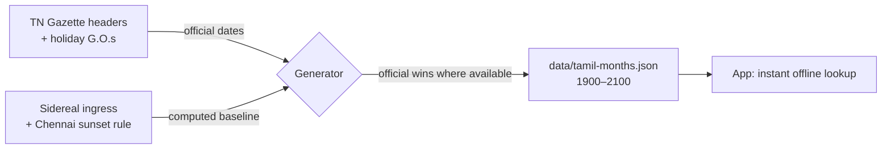
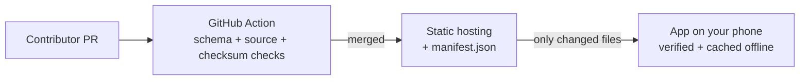

<div align="center">

# நாட்காட்டி · Naatkaati

### ஜோதிடம் இல்லாத, அறிவியல் சார்ந்த தமிழ் நாட்காட்டி
**An open-source, offline-first Tamil calendar. Rooted in Tamil culture and science. No astrology. No ads. No tracking.**


</div>

---

## 🌾 Why Naatkaati?

Most Tamil calendar apps are packed with ads and built around astrology: rahu kalam, horoscopes, muhurtham dates. But many of us just want to know **today's Tamil date, when the next holiday is, and the days that matter to Tamil society**.

Naatkaati is a calendar for that. It treats Tamil time-keeping as what it is: **culture and astronomy**. It works without internet, respects your privacy, and every piece of data in it is open, sourced, and reviewable by anyone.

## ✨ Features

| | Feature | What it does |
|---|---|---|
| 📅 | **Tamil + English dates** | Tamil month, day, and Thiruvalluvar year shown alongside the Gregorian date |
| 🗓️ | **Month view** | A clean calendar grid with both dates and markers for holidays and special days |
| 🏖️ | **Holidays** | Tamil Nadu government, central government, and bank holidays |
| 🎉 | **Tamil cultural days** | Pongal, Uzhavar Thirunal, Thiruvalluvar Day, Kaanum Pongal, Tamil New Year |
| 🕯️ | **Commemoration days** | Anniversaries of thinkers, reformers, and milestones in Tamil language and history |
| 🌅 | **Sky and science** | Sunrise, sunset, moon phase, and eclipses, computed on your device |
| 📜 | **Thirukkural of the day** | One kural every day with a simple Tamil meaning (meanings are being verified; see below) |
| 📱 | **Home-screen widget** | Today's Tamil date, any holiday, and the kural at a glance |
| 🔔 | **Reminders** | Local notifications for the days you care about |
| ✈️ | **Fully offline** | Everything works in airplane mode, from the very first launch |

### ⚙️ Your choice
- **Language:** Tamil (default) or English
- **Tamil New Year:** Thai 1 (default) or Chithirai 1
- **Location:** for accurate sunrise and sunset times

## 🚫 What you will never find here

Being clear about what we *don't* build is part of what makes this app what it is:

- ❌ Rahu kalam, yamagandam, nalla neram, gowri panchangam
- ❌ Horoscopes, rasi palan, porutham, muhurtham dates
- ❌ Ritual instructions or devotional content
- ❌ Ads, paid tiers, accounts, or tracking of any kind

Religious holidays still appear, because you need to know when your office or bank is closed. They're shown simply as holidays.

## 📸 Screenshots

> Coming soon as the app takes shape.

<!--
| Today | Month | Day detail | Widget |
|---|---|---|---|
|  |  |  |  |
-->

## 🔭 How Tamil dates are calculated

The Tamil calendar is a **solar calendar**: a month begins when the Sun enters the next sidereal rasi. But here's the catch we discovered: Tamil Nadu's **official** dates follow the traditional *Vakya* panchangam, which sometimes differs from modern astronomy by a day. Wall calendars and government holidays follow the official dates, so the app does too.



- Every weekly TN Government Gazette prints the Tamil date in its header. A monthly job harvests these, and **official dates always override computed ones**.
- Each month in the data says whether it is `gazette` (official) or `computed`.
- Only the **Thiruvalluvar year** is shown (e.g. திருவள்ளுவர் ஆண்டு 2057).
- Sunrise, sunset and moon data are computed live on-device with [`astronomy-engine`](https://github.com/cosinekitty/astronomy).

## 🗂️ Open data, no backend

There is no server and no database. All content lives as versioned JSON in this repository, and anyone can improve it.



- The app ships with all data bundled, so it works on first launch without internet.
- When online, it checks a tiny `manifest.json` and downloads only what changed.
- Every download is checksum-verified and schema-validated before it replaces anything.
- **Every entry must cite a source.** No source, no merge.

## 🛠️ Tech stack

| Area | Choice |
|---|---|
| Framework | Expo (dev build) + Expo Router |
| Language | TypeScript (strict) |
| State | Redux Toolkit + RTK Query |
| Storage | MMKV |
| Validation | zod (shared by app and CI) |
| Astronomy | astronomy-engine |
| Dates | date-fns + @date-fns/tz |
| Lists | FlashList |
| Images | expo-image |
| i18n | i18next (Tamil first) |
| Widget | react-native-android-widget |
| Native | Local Expo module in Kotlin |

The full package list with the purpose of each one is in [`VISION.md`](./VISION.md#101-packages).

## 🚀 Getting started

### Prerequisites
- Node.js (LTS)
- Android Studio with an emulator or a physical Android device
- An Expo account (for EAS builds)

### Run locally

```bash
git clone <repo-url>
cd naatkaati
npm install

# Build and install the dev client on Android
npx expo run:android

# Start Metro for the dev build
npx expo start --dev-client
```

> ⚠️ Expo Go is not supported. This project uses native modules (MMKV, widget, Kotlin module) and needs a dev build.

### Checks

```bash
npx tsc --noEmit   # type check
npm run lint       # eslint + prettier
npm test           # unit tests
```

## 📁 Project structure

```
app/          Expo Router routes (thin shell)
src/          All app code: features, calendar engine, components, stores, storage
modules/      Local Expo native modules (Kotlin)
data/         Open datasets + manifest.json
tools/        Tamil month generator + validation fixtures
```

The complete tree and conventions are in [`CLAUDE.md`](./CLAUDE.md#3-project-structure-mandatory).

## 🤝 Contributing

Contributions of all kinds are welcome, especially from people who aren't developers.

**📝 Data contributions (no coding needed)**
- Missing or wrong holiday? Edit the file in `data/holidays/` and open a PR.
- Know a commemoration day that matters to Tamil society? Add it to `data/commemorations.json`.
- Every entry needs a `source` (a government order, an official site, or a reliable reference).
- Images must be public domain, openly licensed, or your own work, with license and credit.

**📜 Thirukkural meanings (Tamil readers, this one's for you)**
- The simple Tamil meanings for all 1330 kurals are first drafts and are **not yet verified**. The app says so clearly under every unverified meaning.
- Spotted a mistake? Tap **"பிழையைத் தெரிவி / Report a mistake"** in the app, or open a [kural correction issue](../../issues/new?template=kural-correction.yml).
- Want to review a whole adhikaram (10 kurals)? Comment on the tracking issue and we'll assign it to you.

**💻 Code contributions**
1. Read [`CONTRIBUTING.md`](./CONTRIBUTING.md) and [`VISION.md`](./VISION.md) first. It defines what this app is and isn't.
2. Read [`CLAUDE.md`](./CLAUDE.md) for the strict rules on structure, style, and testing.
3. Open an issue before large changes.
4. Make sure type check, lint, and tests pass.

**🤖 Using AI coding agents?** Both `VISION.md` and `CLAUDE.md` are written to be read by agents too. Point your agent at them before it touches any code.

## 🗺️ Roadmap

**V1**
- [x] Tamil month table generator (official-first) + CI validation
- [ ] Tamil date engine with boundary tests
- [ ] Today, month, and day-detail screens
- [ ] Holidays, cultural days, and commemoration data
- [ ] Thirukkural of the day
- [ ] Sunrise, sunset, and moon phase
- [ ] Android home-screen widget
- [ ] Local reminders
- [ ] Data sync pipeline

**After V1**
- [ ] In-app announcements
- [ ] Push alerts by district for sudden holidays (e.g. rain holidays)
- [ ] Shareable occasion cards for WhatsApp
- [ ] Agricultural season markers (pattam)
- [ ] School exam and holiday calendars
- [ ] ICS feed for Google Calendar
- [ ] iOS build

## 🙏 Acknowledgements

- The Government of Tamil Nadu, whose Gazette headers are the official reference for Tamil dates
- [`tamil-panchanga-calendar`](https://pypi.org/project/tamil-panchanga-calendar/) (solar ingress) and [`kalagana`](https://pypi.org/project/kalagana/) (sunset times) for the computed baseline
- [Project Madurai](https://www.projectmadurai.org/) and [libkural](https://pypi.org/project/libkural/) for the Thirukkural texts
- [GeoNames](https://www.geonames.org/) for city data (CC BY 4.0)
- [`astronomy-engine`](https://github.com/cosinekitty/astronomy) by Don Cross for on-device astronomy
- Thiruvalluvar, for 1330 kurals that still speak to us
- Everyone who contributes data, corrections, and code

## 📄 License

- **Code:** [GPL-3.0-or-later](./LICENSE). You can use, study, change and share it; modified versions you distribute must stay open under the same license.
- **Data** (`data/`): [CC BY-SA 4.0](./data/LICENSE). Reuse it with credit; improved versions stay open. City data includes GeoNames material (CC BY 4.0).
- **Privacy:** no accounts, no ads, no analytics. See [PRIVACY.md](./PRIVACY.md).

---

<div align="center">

Made with ❤️ in Tamil Nadu by [Nalin Sakthivel](https://github.com/nalinsakthivel)

**யாதும் ஊரே யாவரும் கேளிர்**

</div>
